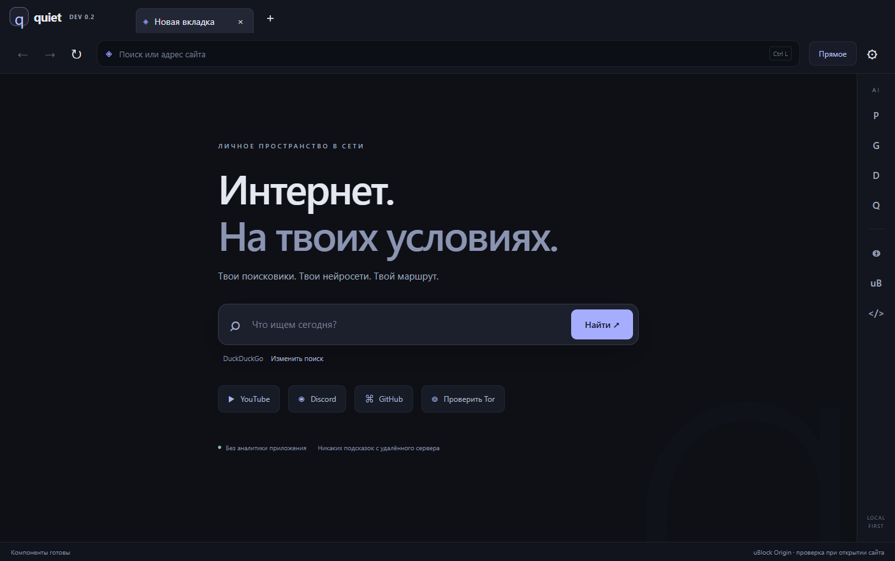

# Quiet Browser

Экспериментальный браузер для Windows x64 с вкладками, собственными поисковиками, AI-панелью и встроенными сетевыми ядрами. Chromium / Electron 44.8.0. Без аналитики приложения, удалённых поисковых подсказок и отправки crash-отчётов.



## Что работает

- Вкладки, адресная строка, назад/вперёд, перезагрузка, сохранение загружаемых файлов с выбором пути.
- Любые поисковики с HTTP/HTTPS URL-шаблоном `{query}`. Предустановлены DuckDuckGo, Brave Search, Google и Яндекс.
- Сайты Perplexity, ChatGPT, DeepSeek и Qwen в боковой панели. Никаких API-ключей; каждый сервис получает отдельные cookies. Страница и выделенный текст не передаются AI автоматически.
- uBlock Origin устанавливается из официального пакета. Фильтрация работает через штатный `chrome.webRequest` без вызова главного процесса для каждого ресурса. Smoke-тест проверяет нейтрализацию рекламы и блокировку трафика при аварии фонового процесса uBO.
- Встроенный Xray: VLESS/Reality, VMess, Trojan, Shadowsocks SIP002, поддерживаемые Xray JSON-конфигурации.
- Встроенный AmneziaWG/WireGuard: `.conf` и совместимые `vpn://`-ключи Amnezia, содержащие клиентскую конфигурацию. Ядро использует userspace netstack и локальный SOCKS5, **без системного TUN, изменения маршрутов Windows и VPN-драйвера**.
- Встроенный Tor Expert Bundle, изолированные Tor-профили, доступ к `.onion`. Остановка Tor не включает прямой маршрут.
- HTTP/SOCKS5 и системный прокси. Явный прокси не содержит запасного `DIRECT` и не обходит localhost автоматически.
- zapret с выбором официальной стратегии YouTube/Discord и автозапуском при открытии браузера.
- Автоматическое получение новых Xray, Tor, zapret и uBO из официальных источников. Проверка SHA-256 обязательна. Обновлённые ядра применяются после перезапуска. AmneziaWG обновляется вместе со сборкой браузера.

## Готовая сборка

Скачать Windows x64 можно в [Releases](https://github.com/Rjkzie/browser/releases). **Для ежедневной работы выбирай ZIP:** распакуй один раз и создай ярлык на `Quiet Browser.exe` внутри папки. Portable `.exe` повторно распаковывает весь комплект при запуске и стартует медленнее. Профиль обоих вариантов хранится в `%APPDATA%/quiet-browser`, включая зашифрованное хранилище подключений.

Открой **Настройки → Подключения**, вставь свой ключ или конфигурацию, сохрани профиль и нажми **Подключить**. После смены маршрута вкладки закрываются. Название и тип профиля показываются в списке; секретная конфигурация в интерфейс обратно не возвращается.

Happ и Amnezia **не запускаются отдельными приложениями**. Браузер содержит собственную панель для совместимых протоколов. Их фирменные интерфейсы, облачные кабинеты и все форматы подписок не встроены. URL подписки HTTP/HTTPS пока не импортируются: вставь отдельный ключ, `.conf` или Xray JSON. `vpn://` не гарантирует конкретный протокол: OpenVPN, IKEv2 и API Amnezia Premium не поддерживаются. Неизвестный формат выдаёт ошибку.

AmneziaWG требует в конфигурации один `[Peer]`, адрес интерфейса и DNS IP-адреса. DNS сайтов идёт через userspace-туннель. Разрешение имени самого VPN-сервера выполняет ОС. Настройка `AllowedIPs` заменяется маршрутами для всего трафика локального браузерного SOCKS5; маршруты ОС при этом не меняются. Скрипты `PreUp/PostUp` не исполняются.

Для Tor выбери маршрут **Tor**, сохрани настройки и дождись `Bootstrapped 100%` внизу окна. **Tor через этот браузер не заменяет Tor Browser:** отсутствует его полноценная защита от fingerprinting. Загрузки файлов, камера и микрофон в Tor отключены. Вход в личный аккаунт раскрывает личность сайту. [Рекомендации Tor Project](https://support.torproject.org/tor-browser/security/using-tor-with-other-browsers/).

## zapret

**Настройки → Компоненты**: выбери стратегию `general*.bat`, сохрани её и запусти. Можно включить запуск вместе с браузером. Работа стратегии зависит от провайдера; готовность обхода не определяется по факту запуска процесса.

В отличие от встроенных VPN-ядер, zapret/WinDivert перехватывает системный трафик и может потребовать UAC. Браузер не устанавливает службу, не изменяет антивирус и не выдаёт себе права администратора. Автоматическая установка запланированных задач/служб отсутствует. Остановку внешнего профиля выполняют его собственные инструменты. [Официальный проект](https://github.com/Flowseal/zapret-discord-youtube).

## Приватность и ограничения

- Веб-страницы работают с sandbox, context isolation и отключённым Node.js. IPC доступен только локальному интерфейсу браузера. Сертификаты TLS проверяются штатно, `webSecurity` не отключается.
- История посещений не записывается приложением. Cookies, local storage, Chromium-кэш и настройки обычного режима сохраняются. **Это не режим без следов на диске.** Tor использует отдельные persistent-разделы, очищаемые перед использованием и при штатном выходе. После сбоя на диске могут оставаться артефакты. Кнопка очистки удаляет cookies и кэш, но не загруженные файлы и не VPN-профили.
- WebRTC ограничен политикой `disable_non_proxied_udp`; QUIC отключён. Это не доказательство отсутствия всех возможных утечек. Полный аудит DNS/IPv6/WebRTC и испытания на реальной VPN/Tor-сети ещё нужны.
- Камера и микрофон запрещены по умолчанию. При включении разрешения каждый запрос подтверждается отдельно. Остальные разрешения устройств запрещены. DevTools можно включить в настройках; localhost открывается как обычный HTTP-адрес.
- Сайты, AI-сервисы и VPN-серверы имеют собственную политику обработки данных. Подключение личного аккаунта не становится анонимным.
- VPN-профили сохраняются через Electron `safeStorage` / Windows DPAPI. При недоступном шифровании сохранение отклоняется. В настройках JSON хранится только ID профиля. Защита DPAPI не скрывает данные от вредоносной программы в том же аккаунте Windows.
- Локальные SOCKS-порты слушают только `127.0.0.1`. Другие приложения не перенаправляются в них автоматически, но локальные процессы могут обратиться к открытому порту сами.
- Системный прокси может содержать исключения и прямой маршрут ОС. Для строгого маршрута выбирай явный SOCKS5/HTTP, VPN-профиль или Tor. При падении ядра нет автоматического переключения на прямой интернет.
- Обновления обращаются к GitHub, GitHub release assets и Tor Project. Это сетевые запросы обновления, без ID пользователя и истории. Их можно отключить. В Tor проверки запрещены; для обновления надо явно выбрать другой маршрут. SHA-256 получен по HTTPS, отдельная проверка PGP-подписей Tor пока не реализована.
- uBO работает через адаптер неполного API Electron. Контекстные меню и часть команд управления вкладками расширения не реализованы. Нет гарантии совместимости всех scriptlets/косметических фильтров с любым сайтом и будущими версиями uBO. Если расширение не готово, интерфейс сообщает об ошибке; это не утверждение, что блокировщик активен.
- Авторизация OAuth, CAPTCHA, DRM-видео и отдельные AI-сайты могут ограничивать сторонние браузеры. Их доступность на конкретном аккаунте/в регионе не проверялась.
- Автообновление самого Electron и браузера пока требует новой сборки. Браузер экспериментальный; полноценного независимого security-аудита нет.

## Разработка

Windows 10/11 x64, Node.js 24+, npm, Go 1.25+ и доступ к npm/GitHub/Tor Project. Права администратора для разработки браузера и userspace VPN не требуются.

```powershell
npm ci
npm run bundle:components
npm run build:native
npm test
cd native/awg
go test -v ./...
cd ../..
npm run smoke
npm start
```

Сборка `.exe`:

```powershell
npm run build
```

Результат: `release/Quiet-Browser-0.2.0-Windows-x64.zip` и portable `.exe`. Компоненты копируются в ресурсы сборки; `node_modules`, ключи, профили пользователей и локальные журналы в Git не добавляются. Для воспроизводимости зависимостей включены `package-lock.json` и `go.sum`. Версии сторонних компонентов фиксируются в `components/manifest.json` внутри готовой сборки; загрузчик перед сборкой получает актуальные upstream-релизы, поэтому весь бинарный пакет не является побитно воспроизводимым.

Производительность: `npm run perf` запускает локальный HTTP-сервер, страницу со 160 ресурсами, настоящие правила блокировки и отдельный временный профиль Chrome для сравнения. `QUIET_PERF_ASSERT=1` проверяет ограничения на перерисовки вкладок, число вызовов фонового JS со стороны главного процесса и время повторных загрузок. `QUIET_PERF_OUTPUT` сохраняет JSON. Пользовательские профили и интернет-страницы в этом тесте не используются. Синтетическая локальная страница не доказывает одинаковую скорость на всех сайтах. Холодная первая компиляция правил uBlock всё ещё занимает несколько секунд; обычный запуск заранее начинает её в фоне, сохраняя блокировку до готовности.

`npm test` проверяет URL/поисковики, прокси, SHA-256 и импорт профилей. `npm run smoke` запускает настоящие Electron-окна с отдельным временным профилем: навигация, sandbox, IPC-изоляция, uBO, разделение cookies и отсутствие прямого fallback при недоступном SOCKS. Go-тест создаёт два локальных ядра и проверяет обмен данными через WireGuard и AmneziaWG. Пользовательские ключи для тестов не нужны.

Реальный внешний VPN-сервер, успешный Tor bootstrap и zapret у конкретного провайдера этими тестами не проверяются. Не следует трактовать тесты как доказательство абсолютной анонимности.

## Исходники и лицензии

`src/` — Electron и интерфейс; `native/awg/` — userspace SOCKS5 поверх AmneziaWG; `scripts/` — комплектация; `test/` — проверки. Код оболочки — MIT. Сторонние компоненты сохраняют собственные лицензии и атрибуцию: [THIRD-PARTY.md](docs/THIRD-PARTY.md). Проект не связан с Happ, Amnezia, Tor Project или авторами uBlock Origin.
